  

<h1 align="center">✦ SAJID MAHMUD SAYAN ✦</h1>

  <strong>UI Master &amp; Creative Technologist &middot; Full-Stack Builder &middot; Prompt Engineer</strong>

  

  
  
  
  
  
  

---

## 👨‍💻 01 / Overview

> I am **Sajid Mahmud Sayan**, a builder with 3+ years of hands-on software development experience. I specialize in crafting high-polish, interactive digital interfaces with **Next.js** and **Three.js**, engineering scalable full-stack web applications, architecting databases with **SQLite**, and designing high-precision **AI prompts & workflows**.

<table>
  <tr>
    <td width="25%" align="center" valign="top">
       
      🎨 
      <strong>UI &amp; Frontend</strong> 
      <code>Master</code> Tier 
      Next.js &middot; Three.js &middot; WebGL
        
    </td>
    <td width="25%" align="center" valign="top">
       
      ⚡ 
      <strong>Full Stack &amp; Backend</strong> 
      <code>Intermediate</code> Tier 
      Node.js &middot; APIs &middot; Architecture
        
    </td>
    <td width="25%" align="center" valign="top">
       
      🤖 
      <strong>AI Engineering</strong> 
      <code>Advanced</code> Tier 
      Prompt Design &middot; LLM Systems
        
    </td>
    <td width="25%" align="center" valign="top">
       
      💾 
      <strong>Database</strong> 
      <code>Experienced</code> Tier 
      SQLite Relational Engine
        
    </td>
  </tr>
</table>

---

## ⚡ 02 / Technical Skills & Expertise

### 💎 UI & Frontend Architecture `[ MASTER ]`

  
  
  
  
  
  
  
  

* Master-level craftsmanship in responsive interfaces, 3D Canvas scenes with Three.js, component architecture in Next.js, fluid CSS micro-animations, and visual hierarchy.

### ⚙️ Full-Stack & Backend Engineering `[ INTERMEDIATE ]`

  
  
  
  
  

* Intermediate-level strength across full-stack integration, building resilient backend services, handling server-side rendering, and connecting client-side interfaces to RESTful endpoints.

### 🤖 Prompt Engineering & AI Systems `[ ADVANCED ]`

  
  
  

* Deep understanding of prompt structure, chain-of-thought system prompts, context optimization, structured JSON extraction, and integrating AI into practical applications.

### 💾 Database Architecture `[ EXPERIENCED ]`

  
  
  

* Strong database fundamentals with SQLite, schema normalization, index strategies, efficient querying, and local embedded data storage.

---

## 📊 03 / Skills & Proficiency Matrix

  

---

## 📈 04 / GitHub Profile Analytics & Charts

  
  

  

---

## 💬 05 / Connect With Me

<table>
  <tr>
    <td width="50%" valign="top">
       
      💬 <strong>Discord</strong> 
      Username: <a href="https://discord.com/users/aurasqlm"><code>aurasqlm</code></a>
        
      📘 <strong>Facebook</strong> 
      Profile: <a href="https://www.facebook.com/sajidmahmudsayansayan"><code>sajidmahmudsayansayan</code></a>
        
    </td>
    <td width="50%" valign="top">
       
      🌐 <strong>Portfolio</strong> 
      Live: <a href="https://sajidmsayan.pages.dev"><code>sajidmsayan.pages.dev</code></a>
        
      ✉️ <strong>Email</strong> 
      Direct: <a href="mailto:sajidmsayan@gmail.com"><code>sajidmsayan@gmail.com</code></a>
        
    </td>
  </tr>
</table>

 

  

  <em>Crafting intentional interfaces, mastering 3D web systems, and shipping experiences that leave a mark.</em>

